<h1 align="center">bimmer-lab apps</h1>

Apps for BMW iDrive 7 head units (MGU), installed through the community MGU Store.

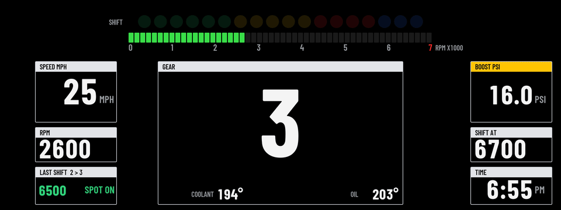

## Cluster Themes

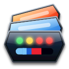

Redraws the whole instrument cluster in a theme of your choice: a GT3 race dash, an M-style cluster, a Sport view, Minimal, Roadster round dials, Track, Drag with a 0 to 60 timer, Rally with a G-meter, Retro 80s, Cruise, or Dyno, a tile dash in BMW M colours. Pick the theme on the center screen, or let it follow the SPORT / COMFORT / ECO PRO buttons. [Read more](apps/cluster_themes/README.md)

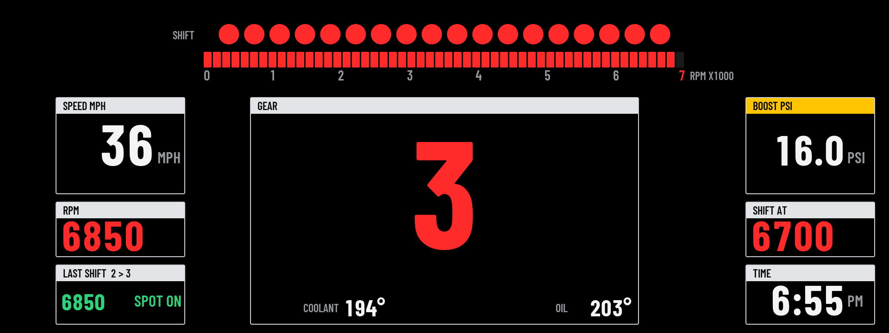

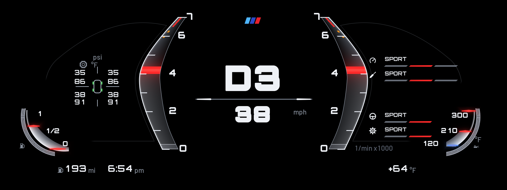

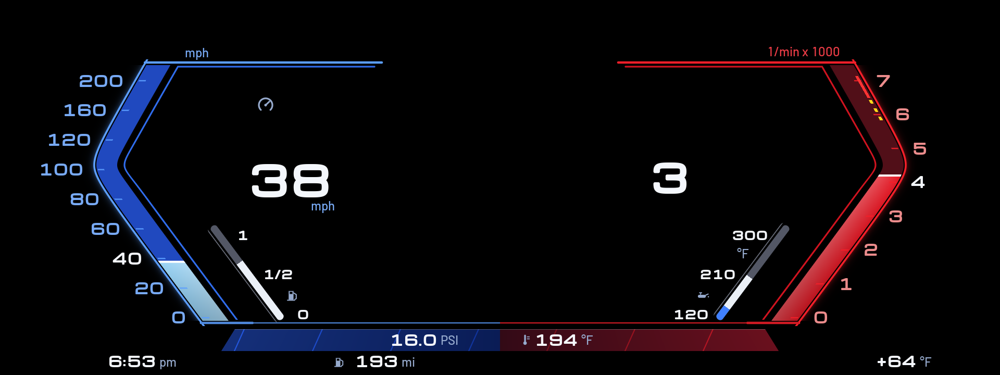

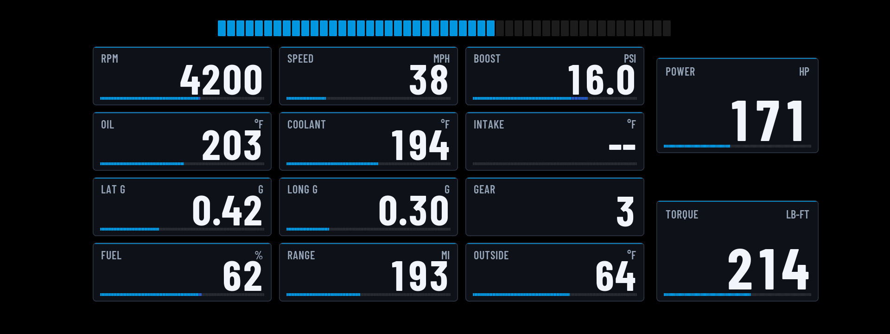

## HUD Widgets

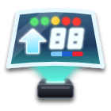

Puts your own readouts on the windshield HUD: gear, shift lights, boost, oil, coolant and intake temperatures, a G-meter and trip figures. Ten layouts, in Classic, M and Night colours (Cruise and Retro bring their own). [Read more](apps/idrive_hud_widgets/README.md)

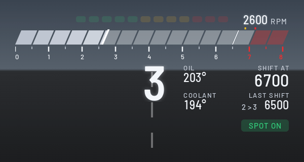

<table align="center">
  <tr>
    <th align="center">Daily</th>
    <th align="center">Sport</th>
    <th align="center">Redline</th>
  </tr>
  <tr>
    <td>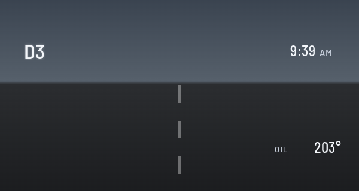</td>
    <td>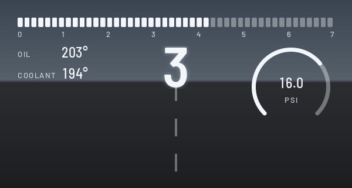</td>
    <td>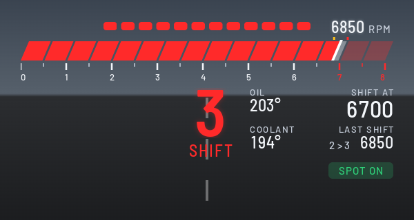</td>
  </tr>
</table>

## Setting up

Each app has its own page on the center screen, opened from the apps menu. Pick a theme or layout there, give each drive mode its own, choose what every readout shows, and set your time zone and units.

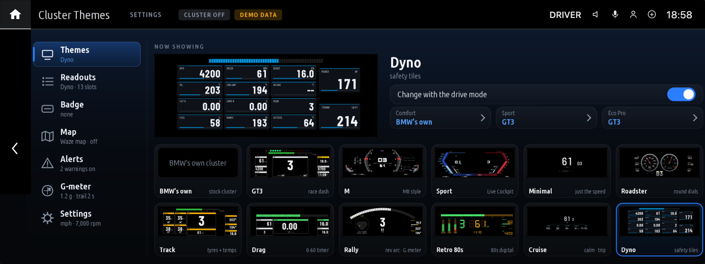

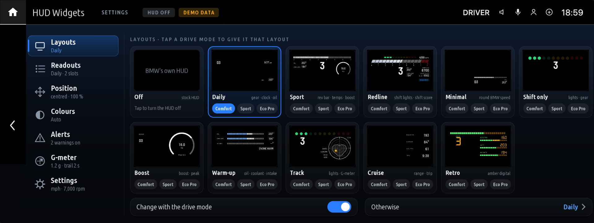

## Install

1. Install **cluster-render** first. Both apps draw through it. It comes from the `robertnisipeanu/idrive-apps` Store source. With version 0.5.1 or newer, a cluster theme and a HUD layout can show at the same time.
2. In the Store, go to **Settings, Add source**, enter **`bimmer-lab/apps`**, and install the apps you want.
3. Open the app from the apps menu on the center screen to pick a theme or layout.
4. The head unit's clock runs on UTC, so set **Settings, Time zone (clock)** to your zone once (for example US Eastern). Named zones change for daylight saving by themselves.

The Store builds each app on the car from this repo. No BMW code is in it. Both apps are tested on a 2020 X3 M40i; each app's page says what has been checked on the car and what is still open. Version history is in [CHANGELOG.md](CHANGELOG.md).

## Use at your own risk

These are unofficial apps made by hobbyists. They are not made, approved or supported by BMW, and the people who wrote them are not responsible for anything that happens to your car or to you while using them.

- Installing apps that don't come from BMW on your head unit is done at your own risk and may affect your warranty.
- The apps only read data from the car. They never write to or change any control unit.
- A cluster theme or HUD layout draws over BMW's own displays. Readouts are for information only: don't rely on them for safety, and always follow BMW's own warnings. If anything looks wrong, pick Off and BMW's display comes back.
- Don't set up or change the apps while driving. Keep your eyes on the road.
- The apps are provided as is, without any warranty, under the MIT licence. You use them entirely at your own risk.

## Credits

- [cauliflowermossgrape/idrive7-apps](https://github.com/cauliflowermossgrape/idrive7-apps): the MGU App Kit (MIT) these apps are built on, and the Redline app the shift scoring comes from (Redline's HUD by [@biscotit](https://github.com/biscotit)).
- [robertnisipeanu/idrive-apps](https://github.com/robertnisipeanu/idrive-apps): cluster-render, which draws on the HUD and the cluster.
- Barlow, Michroma and Orbitron typefaces (SIL Open Font License).

## Licence

MIT. Third-party parts are listed in each app's `NOTICE`. To work on the apps, see [docs/DEVELOPING.md](docs/DEVELOPING.md).
