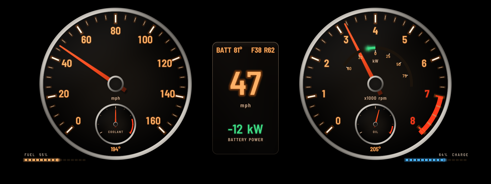
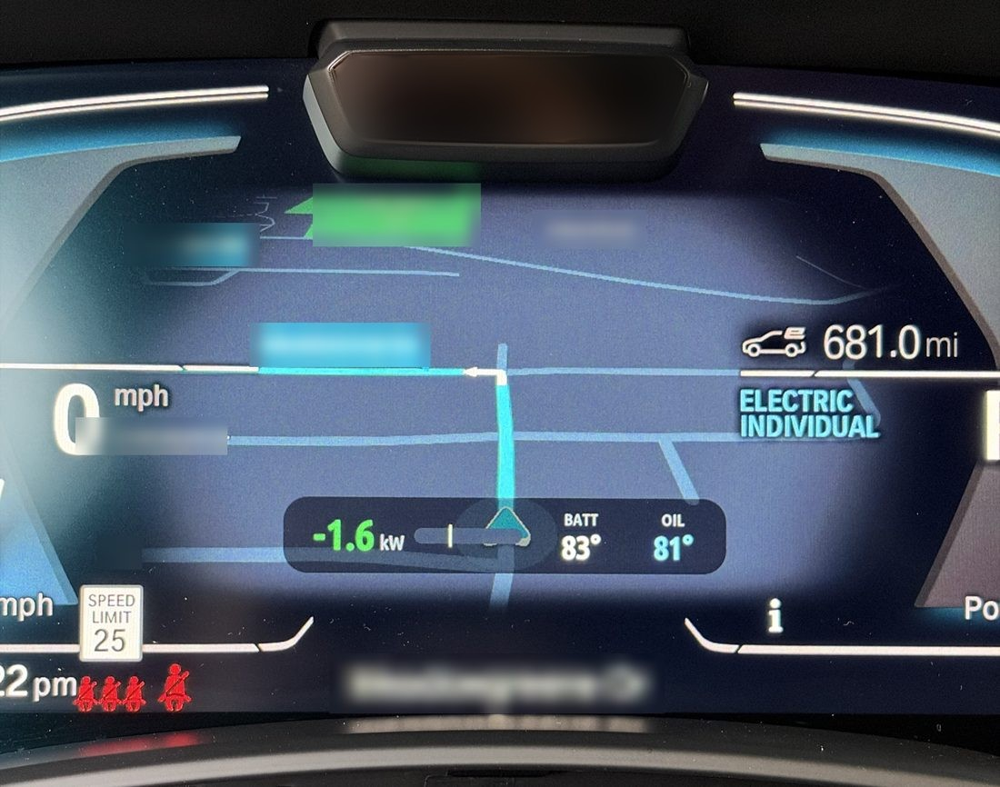
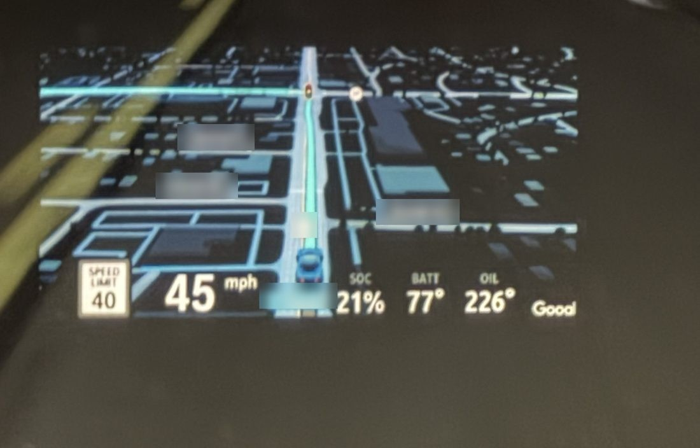
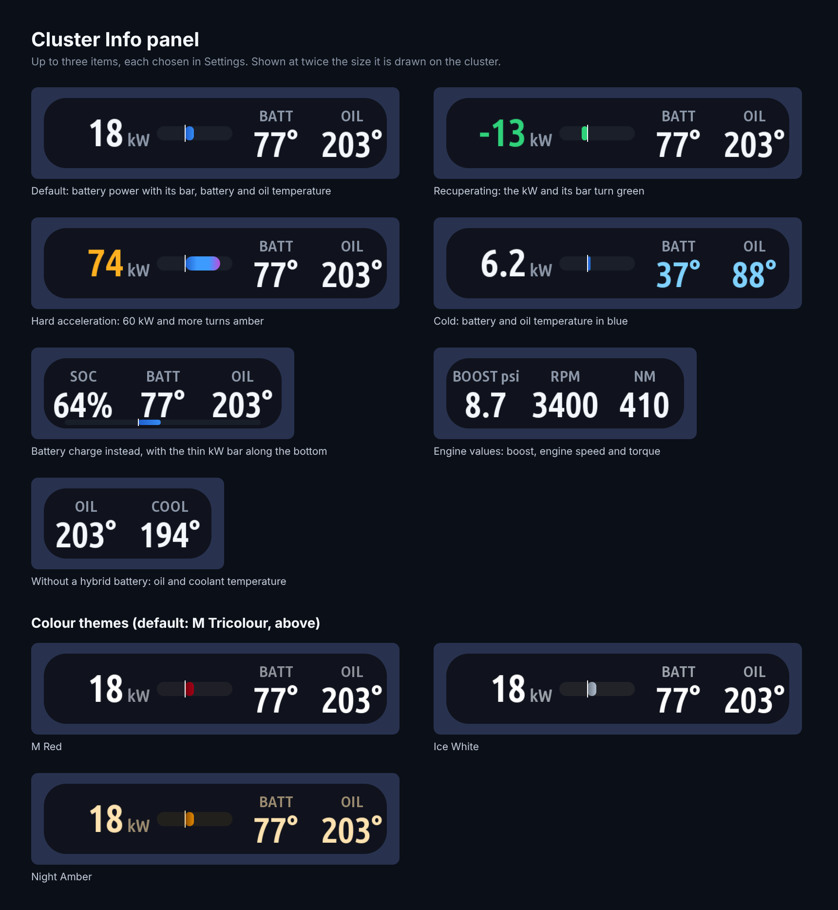

> [!WARNING]
> **Disclaimer.** This is an independent personal project by eroobeeroo. It is not affiliated with, endorsed by
> or supported by any vehicle manufacturer, equipment supplier or their partners.
>
> Everything in this repository is provided "as is", without warranty of any kind. Changing a vehicle's software,
> electronics or displays can cause malfunctions, distract the driver, void warranties, break local regulations
> and create safety risks. I am not liable for any damage, injury, loss or other consequence arising from the use
> or misuse of anything in this repository. **I do not recommend that anyone try this on their own vehicle**; if
> you do, you do so entirely at your own risk.

# iDrive 7 cluster apps

Three apps for the BMW iDrive 7 head unit (MGU), by eroobeeroo. **They are free: if you paid for one, ask for a
refund.**

| App | What it does |
|---|---|
| **[Cluster Info](#cluster-info)** | a small panel of live values over the Waze map in the cluster or on the HUD, and turn signal arrows on the HUD |
| **[Cluster Layouts](apps/cluster_layouts/README.md)** | your own layout on the whole instrument cluster, drawn by the cluster itself: eight layouts, each in three colour sets and with three centres (readings, Waze over the layout, stock) |
| **[Cluster Centre](apps/cluster_centre/README.md)** | the factory cluster kept, its centre taken over by pages of live data (temperatures, fuel and boost, warm-up, turbo cool-down, eDrive, a 0-60 timer, custom pages) |



## Installing

Add this repository as a source in the [MGU Store](https://github.com/robertnisipeanu/mgu-store) and install the
apps you want; the head unit builds each one from source. What they need comes from the Store's own sources,
which it installs with them:

- the GPU renderer (`idrive7-renderd`) and controller gate (`mgu-inputgate`) from
  [cauliflowermossgrape/idrive7-apps](https://github.com/cauliflowermossgrape/idrive7-apps);
- the cluster renderer (`cluster-render`) that Cluster Layouts and Cluster Centre draw with, and Waze on cluster,
  the map Cluster Info sits on, from [robertnisipeanu/idrive-apps](https://github.com/robertnisipeanu/idrive-apps).

[eroobeeroo/idrive7-apps](https://github.com/eroobeeroo/idrive7-apps) is optional: it has **eDrive Live**, which
shares the battery's charge, power and temperature with these apps. On a plug-in hybrid it is where Cluster Layouts and
Cluster Centre get the charge and power: they leave the battery unit to it rather than read it too.

Cluster Info is in eroobeeroo/idrive7-apps as well. Install it from only one of the two: if both are installed,
the Store adds the second beside the first as a separate app (`cluster_info2`).

## Cluster Info

A small panel of up to three live values over the Waze map in the instrument cluster or on the HUD, and turn
signal arrows on the HUD. It works with [Waze on cluster](https://github.com/robertnisipeanu/idrive-apps), which puts
the map there. What it shows, its settings and how other apps can give it values are in
[apps/cluster_info/README.md](apps/cluster_info/README.md).

### What it looks like



*In the instrument cluster: the battery's power with its bar (recuperating, in green), battery and oil temperature.*



*On the HUD: battery charge, battery and oil temperature, right of the HUD's own speed readout.*



*The panel as the app draws it, at twice its size on the cluster: what it can show, and its four colour themes.*

(Street names in the photos are blurred.)

## Repository layout

| Path | What |
|---|---|
| `apps/cluster_info/` | Cluster Info: `main.js` (its page), `overlay.js` (the panel over the map), `providers.js` (values from other apps), `indicators.js` (turn signals and day / night), `cluster_render_client.js` (the cluster renderer's protocol), `app.json` (manifest, signals and settings) |
| `apps/cluster_layouts/`, `apps/cluster_centre/` | the other two apps; each holds its own copy of the shared files it uses |
| `shared/` | the code those two share (the cluster engine and shaders, car data, fonts, the clock, logs, the signed credit); `node tools/sync_shared.js` copies it into each app |
| `tools/` | their tests, the cluster previews (`preview.js`, `preview_centre.js`), the font baker and the credit signer |
| `kit/runtime/` | the app kit's runtime the build bundles into each app (canvas, fonts, gauges, themes, settings, the controller and renderer clients) |
| `kit/platform/`, `kit/localization/` | the packages' permissions and the Chinese build's credit |
| `kit/tools/build.py` | builds an app package (with `pack_data.py`, `localize.py`, `make_icon.js`, `oapgen/`) |
| `kit/tools/test_*.js` | Cluster Info's and the kit's tests |
| `mgu-repo.json` | tells the Store how to build the apps; each app's `app.json` says what it requires |

## Development

The tests need Node.js only (no SDK, renderer or car):

```sh
node kit/tools/test_runtime.js
node kit/tools/test_cluster_info_overlay.js
node kit/tools/test_cluster_info.js
for t in engine app centre data finder logs providers shared signals; do node tools/test_$t.js; done
```

After changing anything in `shared/`, run `node tools/sync_shared.js`. `python3 kit/tools/build.py <app id>` builds a
package into `dist/`, and `node tools/test_built.js` starts each built app on the kit's stubbed head unit. Both need
BMW's oap-sdk in `oap-sdk/`, taken from your own head unit (see eroobeeroo/idrive7-apps,
`kit/tools/extract_sdk.js`). The SDK and the built packages, which contain it, are never committed. The Store
builds on the head unit with the unit's own SDK.

## License

Copyright (C) 2026 eroobeeroo. [PolyForm Noncommercial License 1.0.0](LICENSE): free to use, change and share for
any noncommercial purpose (your own car, a friend's, a hobby project), with this licence and the copyright notice
kept. **Commercial use is not licensed: nobody may sell these apps or charge for installing, coding or bundling
them.** If you paid for them, ask for a refund. That covers everything here except the parts below, which keep
their own licenses. Versions published before 10 November 2026 remain under the GPL-3.0-or-later they were
published with.

- The app kit (`kit/`) is from [cauliflowermossgrape/idrive7-apps](https://github.com/cauliflowermossgrape/idrive7-apps)
  through eroobeeroo/idrive7-apps, under its MIT license ([LICENSE-MIT](LICENSE-MIT), `kit/LICENSE`). Cluster Info
  was written there; versions of it published in eroobeeroo/idrive7-apps before this repository remain under the MIT
  license they were published with.
- The cluster renderer's Node client (`cluster_render_client.js`) is by Robert Nisipeanu, MPL-2.0, as its header says.
- Fonts: the cluster apps' Barlow, Michroma and Orbitron atlases and the bundled Noto Sans SC glyphs are under the SIL Open
  Font License 1.1 (`shared/NOTICE`, `kit/runtime/fonts/OFL-NotoSansSC.txt`).
- The Chinese translation's credit is in [NOTICE.zh-CN.md](NOTICE.zh-CN.md). More in [NOTICE.md](NOTICE.md).
